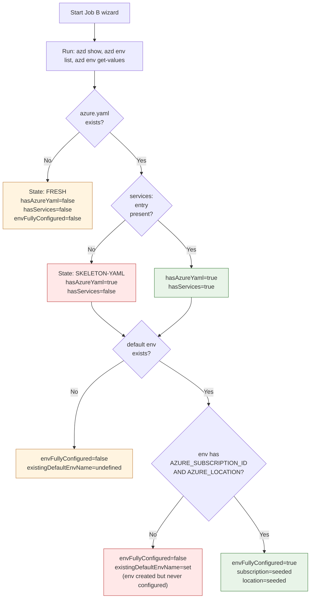
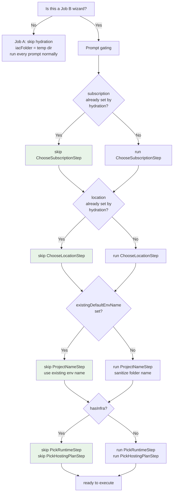
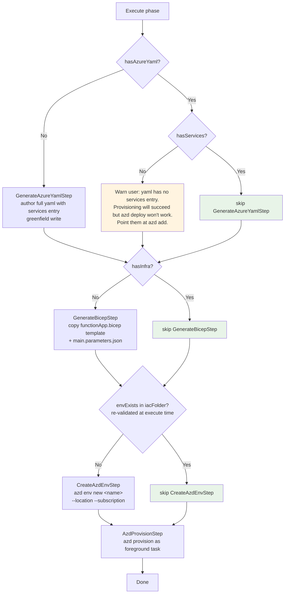
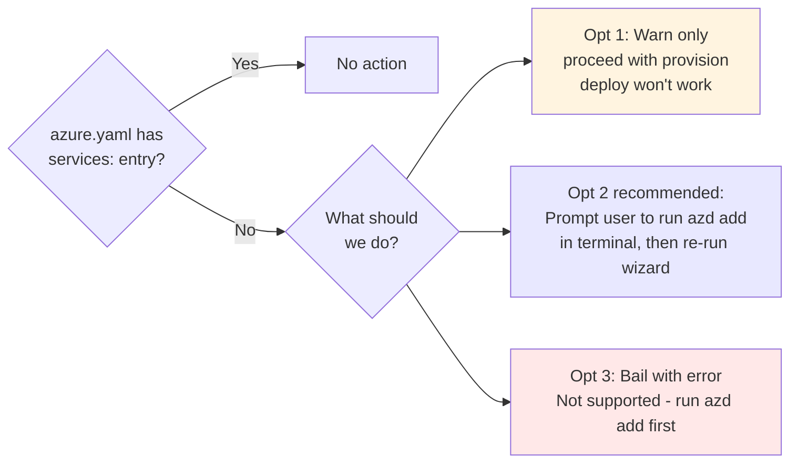
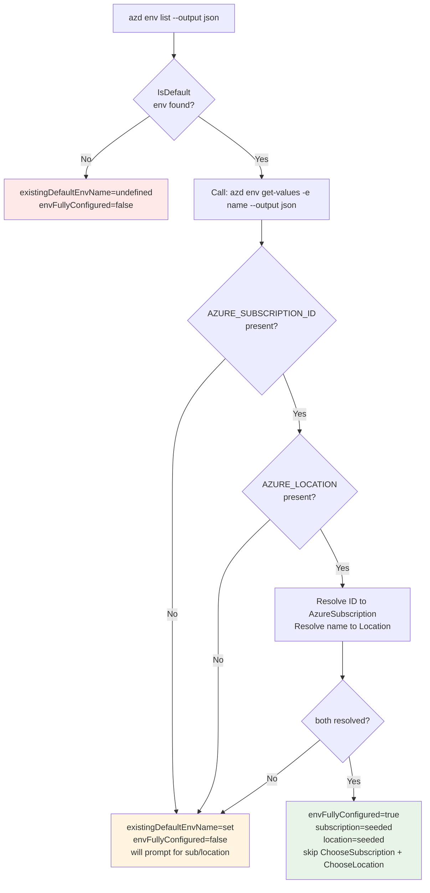

# Plan: Robust AZD Wizard — Two Jobs, Three Project States

Recast the "Create Function App" experience around two distinct jobs-to-be-done, a shared execution pipeline, and three initial azd-project states. Fix the PR #120 review comments as a natural byproduct.

## State & flow diagrams

### 1. State classification (Job B hydration)

### 2. Prompt-side gating

### 3. Execute-side gating

### 4. The services-entry decision

### 5. envFullyConfigured detail

Context field matrix after hydration:

| Detected | `hasAzureYaml` | `hasServices` | `existingDefaultEnvName` | `envFullyConfigured` | `subscription` | `location` |
|---|---|---|---|---|---|---|
| Nothing | `false` | `false` | `undefined` | `false` | unset | unset |
| yaml, no svc, no env | `true` | `false` | `undefined` | `false` | unset | unset |
| yaml + svc, no env | `true` | `true` | `undefined` | `false` | unset | unset |
| yaml + svc, env without values | `true` | `true` | `"dev"` | `false` | unset | unset |
| yaml + svc, env with values | `true` | `true` | `"dev"` | `true` | seeded | seeded |

## Jobs-to-be-done

**Job A — "Create an empty Function App in Azure"**
- User wants an Azure resource. No workspace commitment.
- Template (`azure.yaml` + `infra/`) is generated in our *temp project dir* (via existing `TempProjectManager`), never in the workspace.
- After `azd provision`, the temp dir can be disposed. The user has a Function App in Azure with no local bookkeeping.
- Effectively equivalent to today's "Deploy Only" path in `OfferSaveStep`, but it becomes the whole command, not a branch.

**Job B — "Deploy this project as a Function App"**
- User wants the Function App wired to their workspace, so subsequent `azd deploy` / `azd provision` work.
- Template ends up saved in the workspace folder; env is persisted under `.azure/` there.

Both jobs execute the **same pipeline**: generate (if needed) -> create env -> provision. They differ only in:
- Where `iacFolder` lives (temp vs workspace).
- How much we can skip based on existing project state (Job A always generates; Job B may not).

## Job selection

Two independent commands, each targeting one job:
- `vscode-azure.functions.createInAzure` — Job A. Label: "Create Function App in Azure...". Available always.
- `vscode-azure.functions.deployProject` — Job B. Label: "Deploy Project as Function App...". Only sensible when a workspace folder is open.

For the existing catch-all entry point (current `vscode-azure.functions.create` and any tree/palette handlers that say just "Create Function App"), infer:
- No workspace folder open -> Job A.
- Workspace folder open -> ask: "What do you want to do?" with two options (A or B) using a `showSmartQuickPick`. Default and initial highlight = B when an `azure.yaml` or Function-App-shaped files are present in the workspace; otherwise A.

This makes intent explicit, keeps existing UX paths working, and puts the detection logic in exactly one place.

## Three project states (Job B only)

Once Job B is chosen, the shape of the workspace drives a three-way gate. `azure.yaml` presence and default-env presence are treated as fully independent axes — the "no yaml + yes env" corner is discarded as a don't-care (we fall through the fresh branch).

| `azure.yaml` | default env | State | Pipeline behavior |
|---|---|---|---|
| No | No/Yes | **Fresh** | Generate `azure.yaml` + `infra/` from our template. `azd env new <name>`. `azd provision`. |
| Yes | No | **Post-clone** | Do not touch yaml. Prompt for env name. `azd env new <name>`. Generate `infra/` only if missing (see orthogonal axis). `azd provision`. |
| Yes | Yes | **Bootstrapped** | Do not touch yaml. Hydrate sub/loc/env from env values. Generate `infra/` only if missing. Confirm provision. `azd provision`. |

### Orthogonal axis: infra presence

Whether `infra/main.bicep` exists is independent of state and only controls whether `GenerateBicepStep` runs:
- Missing -> generate from template, pull runtime/hostingPlan prompts.
- Present -> skip generation, skip runtime/hostingPlan prompts (they'd be unused).

### Job A always runs Fresh

Because Job A uses a temp `iacFolder` that's always empty, it's categorically the Fresh state. No hydration, no state detection. Keeps Job A trivial to reason about.

## Why this avoids the problems in the PR comments

- **`envAlreadyExists` vs `iacFolder` mismatch (PR Threads 1, 3, 4)**: gone. Hydration only runs for Job B, and only reads values from the workspace — which *is* the `iacFolder` for Job B. Job A never hydrates. There's no path where hydration data is applied against a mismatched cwd.
- **`envUpdate`-as-conflict-path is wrong (PR Thread 2)**: gone. Env creation only happens in Fresh or Post-clone states, both of which by definition have no existing env. Bootstrapped state never calls `azd env new`. No conflict resolution needed.
- **"No services in `azure.yaml`" (TODO)**: fixed on the Fresh path because we author the whole file, services entry included. For Post-clone/Bootstrapped, the user's own yaml governs; if it has no services, we don't guess — the `azd provision` step will surface the issue, and we can consider adding an explicit check + message before running it.

## Shared pipeline — refined step list

All steps are reused between Job A and Job B; gates differ.

Prompt steps (in order):
1. **`HydrateAzdInfoStep`** (Job B only) — runs `azd show` + `azd env list` + `azd env get-values` to classify state and seed subscription/location/env where available.
2. **`ChooseSubscriptionStep`** — skip if hydrated.
3. **`ChooseLocationStep`** — skip if hydrated.
4. **`ProjectNameStep`** (new) — single name prompt; default from workspace-folder name or `azd show.name`; derives `environmentName`, `azdServiceName`, Function App name. Skip if all three are already set. For Job B Bootstrapped state, the existing env's name wins, so prompt is skipped.
5. **`PickRuntimeStep`** — skip if `hasInfra`.
6. **`PickHostingPlanStep`** — skip if `hasInfra`.
7. **`ConfirmProvisionStep`** (new, replaces `OfferSaveStep`) — in Job B Bootstrapped state: yes/no "Provision `<envName>` now?". Otherwise: skipped (Job A always provisions, Job B Fresh/Post-clone always provision after confirming at an earlier step if we decide to keep that confirmation at all — probably unnecessary if the user just ran a command literally named "Deploy Project").

Execute steps (in order):
1. **`GenerateAzureYamlStep`** — shouldExecute: `!hasAzureYaml`. Runs `azd init --minimal --no-prompt` *then* writes our services entry by a single greenfield file write (we're authoring the whole file on the fresh path; "no yaml manipulation" was about not mutating user content). Alternative: write the whole `azure.yaml` ourselves from a small template string and skip `azd init`. Pick one; see Decisions.
2. **`GenerateBicepStep`** — shouldExecute: `!hasInfra`. Copies the shipped `functionApp.bicep` template.
3. **`CreateAzdEnvStep`** — shouldExecute: no default env in target `iacFolder`. Calls `azd env new <name>` with `--location` and `--subscription`. Re-validates env existence in `iacFolder` at execute time (PR Thread 3). No more `envUpdate`-as-conflict-path.
4. **`AzdProvisionStep`** — shouldExecute: `context.provision === true`. Runs `azd provision` as foreground task.

## `TempProjectManager` role

- Job A: always used; `iacFolder = await tempProjectManager.createProjectDir()`.
- Job B: never used; `iacFolder = workspaceFolder.uri`.

## `OfferSaveStep` retirement

Replaced by the job selection (the three-way picker) + `ConfirmProvisionStep`. The old UI conflated two separate decisions (workspace-vs-temp *and* save-vs-deploy); splitting them by job is cleaner.

## Concrete changes

### `AzdService` (`extensions/vscode-azure/src/azd/AzdService.ts`)
- Add `show(cwd)` — parses `azd show --output json`. `undefined` on non-zero exit.
- Add `envGetValues(cwd, envName)` — parses `azd env get-values -e <name> --output json`.
- Add `envExists(cwd, name)` — re-uses `envList`; used for pre-execute validation in `CreateAzdEnvStep`.
- Keep `envNew`, `envList`, `init`, `provision`, `findAzureYaml`.
- Remove `envUpdate` from conflict-resolution call sites; keep it only if still used for var setting; otherwise delete.

### `AzdWizardContext` (`extensions/vscode-azure/src/azd/wizard/AzdWizardContext.ts`)
- Replace `envAlreadyExists` with:
  - `hasAzureYaml?: boolean`
  - `hasInfra?: boolean`
  - `existingDefaultEnvName?: string`
  - `envIsProvisioned?: boolean`
  - `job: 'createInAzure' | 'deployProject'` (set at wizard start)
  - `projectName?: string`
- JSDoc refresh per PR Thread 4.

### `HydrateAzdInfoStep`
- Only runs when `job === 'deployProject'`.
- `azd show` -> set `hasAzureYaml`, seed `projectName` from `name`.
- Local file check -> `hasInfra`.
- `azd env list` -> set `existingDefaultEnvName`, also set `environmentName`.
- `azd env get-values` on default env -> try to resolve `AZURE_SUBSCRIPTION_ID` and `AZURE_LOCATION` into rich `AzureSubscription` / `Location` objects. If resolution fails, leave those unset (prompts will run as a fallback).
- Seed `iacFolder = workspaceFolder.uri` unconditionally for Job B.

### New `ProjectNameStep`
- Single name prompt, sanitized from folder or `azd show.name`. Seeds `environmentName`, `azdServiceName`, Function App default.
- Retires `EnvironmentNameStep`.

### `CreateAzdEnvStep`
- Re-validate env existence in `context.iacFolder` via `envExists` (PR Thread 3).
- If env exists already -> no-op (Bootstrapped state; shouldn't reach here if `shouldExecute` is correct, but defensive).
- Else -> `azd env new` with `--location`, `--subscription`.
- Remove `envAlreadyExists` branch entirely.

### `GenerateAzureYamlStep`
- shouldExecute: `!context.hasAzureYaml`.
- Produces a complete `azure.yaml` including the services entry in one write. Prefer `azd init --minimal --no-prompt` + a subsequent single-file overwrite, *or* a one-shot template-string write — whichever the team finds less brittle. (No mutation of user files: on the Fresh path the yaml doesn't exist yet; writing it is authoring, not mutation.)

### `GenerateBicepStep`
- shouldExecute: `!context.hasInfra`. Existing logic.

### New `ConfirmProvisionStep`
- Only prompts in Job B Bootstrapped state.
- yes/no "Provision `<envName>` now?" -> sets `context.provision`.
- Other paths: set `provision = true` by default (the user explicitly ran a deploy-flavored command).

### `OfferSaveStep` / `TempProjectManager`
- `OfferSaveStep` is deleted.
- `TempProjectManager` is consumed inside the Job A command entry point to set `iacFolder` before the wizard runs.

### Command layer
- Split the current `functions/CreateFunctionApp.ts` into two wizard entry points sharing a helper that builds the prompt/execute step list from `context.job` plus hydration data:
  - Job A entry -> seeds `iacFolder` from temp, `job = 'createInAzure'`, skips `HydrateAzdInfoStep`.
  - Job B entry -> seeds `iacFolder` from workspace folder, `job = 'deployProject'`, runs `HydrateAzdInfoStep`.
- Register both `functions.createInAzure` and `functions.deployProject` in the manifest.
- Keep a thin `functions.create` shim that shows the A-vs-B picker and forwards; behavior-inferred defaults based on workspace signals.
- Drop the hardcoded `'myfunc'` default; derive from `projectName`.

### Tests
- Extend `MockAzdService` with `show`, `envGetValues`, `envExists`.
- Unit-test `HydrateAzdInfoStep` across Fresh/Post-clone/Bootstrapped states (six cells with `hasInfra` axis).
- Unit-test `CreateAzdEnvStep` for the post-clone path (env doesn't exist in target cwd -> `envNew` called).
- Unit-test `ProjectNameStep` sanitization and derivation.
- Update `CreateFunctionApp.test.ts` for both Job A and Job B entry points.

### Manual verification

Six-cell matrix for Job B (project x env x infra; two axes are orthogonal, "no yaml + env" discarded):

| Yaml | Env | Infra | Expected |
|---|---|---|---|
| No  | No  | No  | Fresh: author yaml + bicep, prompt name/runtime/sub/loc, env new, provision |
| No  | No  | Yes | Fresh-ish: author yaml, skip bicep + runtime/hostingPlan, prompt name/sub/loc, env new, provision |
| Yes | No  | No  | Post-clone: skip yaml, generate bicep, prompt name/runtime/sub/loc, env new, provision |
| Yes | No  | Yes | Post-clone: skip yaml, skip bicep, prompt name/sub/loc, env new, provision |
| Yes | Yes | No  | Bootstrapped: skip yaml, generate bicep (pull runtime/host prompts), confirm provision |
| Yes | Yes | Yes | Bootstrapped: shortest happy path, just confirm provision |

Plus Job A: always same path regardless of workspace state — temp dir is empty, generate everything, env new, provision.

## Decisions / scope

- **Two commands with a smart shim** (Option 3 + 2). Makes jobs explicit in UI and telemetry.
- **Three project states** drive Job B; Job A is always Fresh.
- **Infra presence** is a separate, orthogonal axis that only toggles Bicep generation and runtime/hostingPlan prompts.
- **No yaml mutation**: only greenfield writes on the Fresh path. Bootstrapped/Post-clone users keep their yaml.
- **No env conflict resolution**: by construction, `azd env new` only runs when no env exists in target cwd.
- **`envUpdate`** removed from the wizard flow.
- **`OfferSaveStep`** deleted; decisions moved to job selection + `ConfirmProvisionStep`.
- **Out of scope**: auto-installing azd; supporting "add a Function App to an existing azd project's yaml" (tell user to run `azd add` manually); multi-root nuance beyond `getWorkspaceFolder`.

## Further considerations

1. **Shim behavior when command entry is ambiguous**: should the A-vs-B picker remember the user's last choice per workspace? Probably not for v1 — easy to add later.
2. **Yaml authoring mechanism**: `azd init --minimal` + post-write is more robust to future schema changes; a raw template string is zero dependency. Recommendation: `azd init --minimal` then write yaml ourselves — we already shell out, and it keeps the file format consistent with azd's expectations.
3. **Subscription/location resolution from env values**: existing subscription provider can look up by ID; `Location` resolution needs an ARM call. Keep it best-effort — if resolution is slow/fails, fall back to running the prompt steps.
4. **`azd add` deferral**: we explicitly do not integrate `azd add` into the wizard. If a user with existing yaml wants a Function App service added, they run `azd add` themselves. Document this in the command's description / a notification if we detect yaml-without-services during Job B provisioning attempt.
